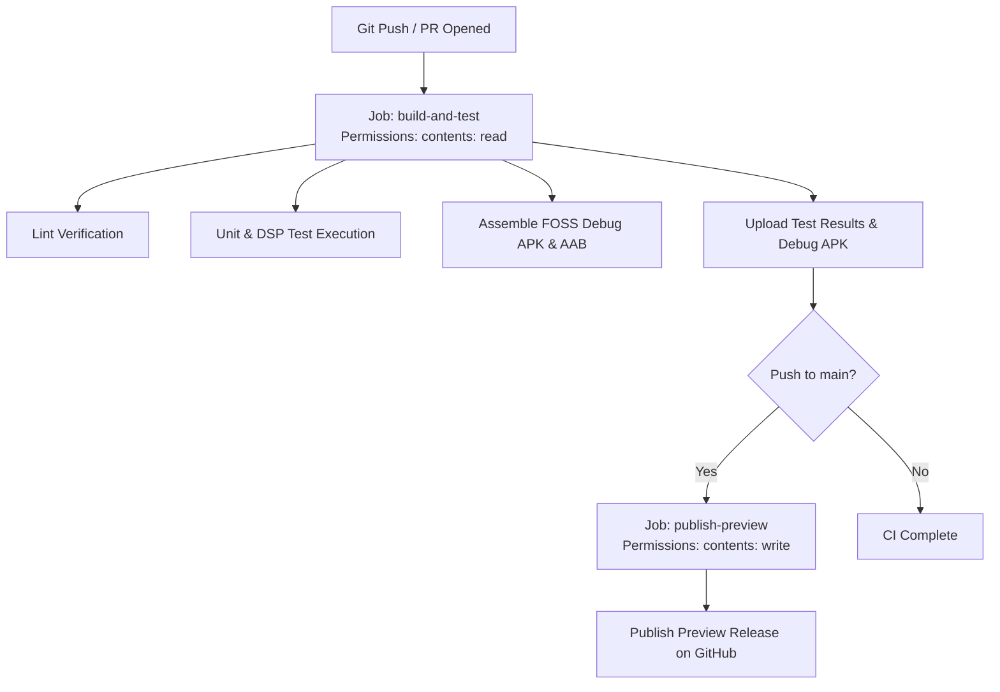

# NØTUNE — CI/CD Pipeline & GitHub Actions Guide

## 1. Workflow Architecture

NØTUNE uses GitHub Actions for continuous integration, linting, automated testing, and release artifact assembly.

The workflow system separates pull request validation from production release publishing following the principle of least privilege.

---

## 2. Workflows Overview

### 1. `android-build.yml` (Continuous Integration)
- **Triggers**: All branch pushes, pull requests, workflow dispatch.
- **Job `build-and-test`**:
  - Permissions: `contents: read` (safe for public fork PRs).
  - Tasks: Lint check (`lintUniversalFossDebug`), Core/Playback/App unit tests, assembly of debug APK and AAB.
  - Artifacts: Test reports, lint reports, debug APK.
- **Job `publish-preview`**:
  - Condition: `if: success() && github.event_name == 'push' && github.ref == 'refs/heads/main'`
  - Permissions: `contents: write`
  - Action: Publishes `preview-latest` pre-release with attached APK.

### 2. `release-apk.yml` (Production Release Publishing)
- **Triggers**: Tag pushes matching `v*` (e.g. `v1.0.0`).
- **Permissions**: `contents: write`
- **Tasks**:
  - Decodes production release keystore from GitHub Secrets.
  - Builds signed `assembleUniversalFossRelease`.
  - Verifies APK signature using Android SDK `apksigner`.
  - Computes and logs SHA-256 checksums and certificate fingerprints.
  - Publishes official production release to GitHub Releases with attached signed APK.

### 3. `codeql.yml` (Security Code Scanning)
- **Triggers**: Weekly cron and pushes to `main`.
- **Tasks**: Static analysis for security vulnerabilities in Java/Kotlin codebase.
